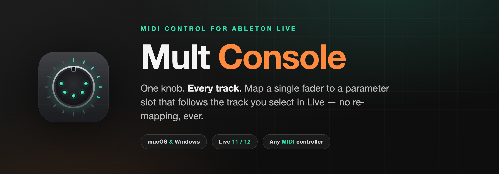
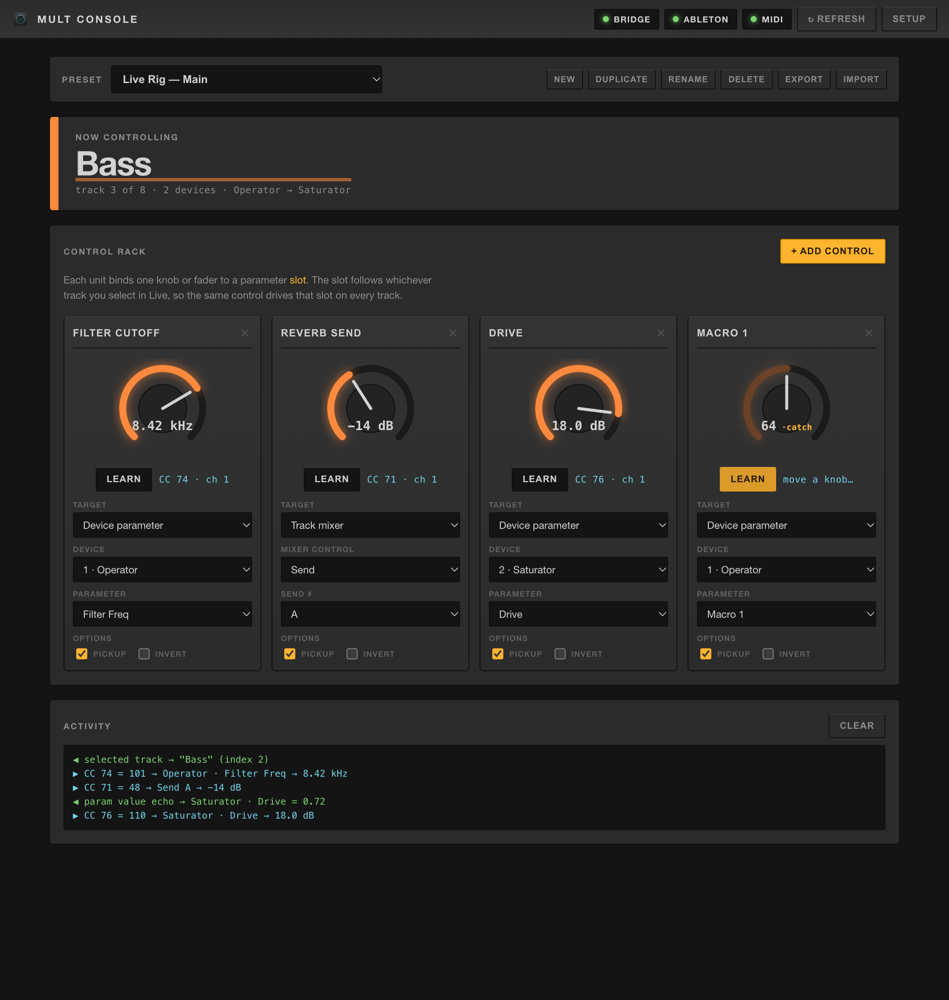
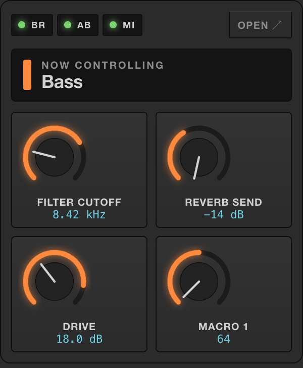
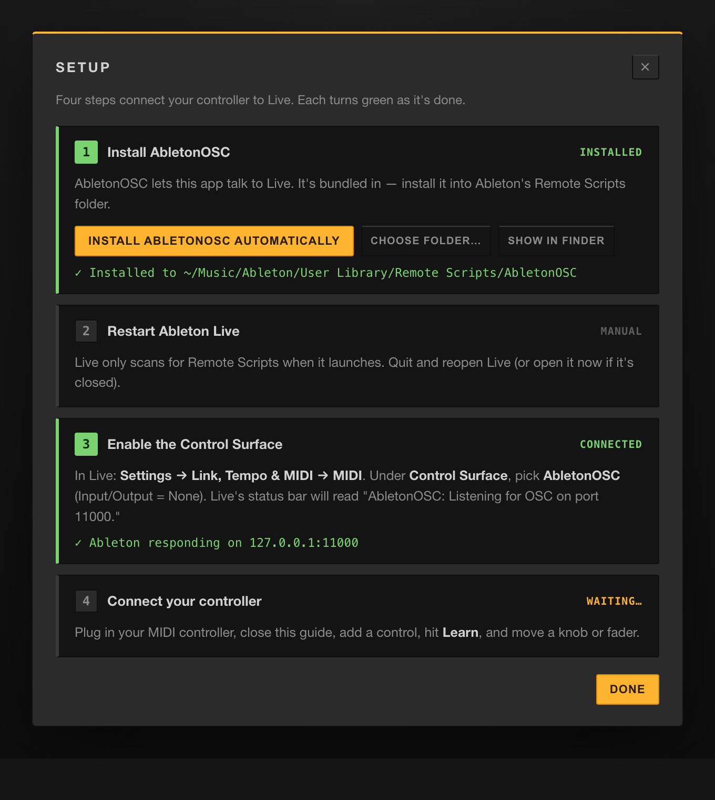
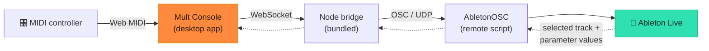

<div align="center">



<br />

**One physical knob that drives the right parameter on whichever track you select in Ableton Live.**
No re-mapping. No scripting. No MIDI-clutter.

<br />

[](https://github.com/MaxFishman/mult-console/releases/latest)
&nbsp;
[](#pricing--licensing)


</div>

---

## The problem it solves

You have one great hardware controller and a session full of tracks. In vanilla Live, a knob is mapped to **one** parameter on **one** device. Want it to control the next track's synth? You re-map. And the next? Re-map again. Performers and producers lose hours to MIDI mapping — and break it the moment they rearrange a set.

**Mult Console maps your knob to a _slot_, not a parameter.** The slot follows the track you have selected. Click a different track in Live and that same physical knob instantly drives the equivalent parameter there. Build the mapping once; it works across your whole set, forever.

> _"Mult"_ — borrowed from modular synthesis, where a **mult** splits one signal to many destinations. One control, routed everywhere it needs to go.

<div align="center">

<br />
<sub>The Control Rack — each unit binds one knob to a slot that follows the selected track. Live knob values, MIDI assignments, and OSC/MIDI activity, all in one window.</sub>
</div>

---

## Why studios buy it

| | |
|---|---|
| 🎛️ **Map once, play everywhere** | A control follows the selected track by position, so one knob drives "Filter Cutoff" on every synth in the set. |
| ⚡ **MIDI Learn in seconds** | Click **Learn**, wiggle a fader — it's bound. CC messages from any class-compliant controller. |
| 🎚️ **Beyond plugin params** | Target device parameters, track mixer (volume, pan, sends, mute/solo/arm), or scrub the arrangement timeline. |
| 🪄 **Macro-friendly** | Point at a Rack's Macros to sweep several plugin parameters from a single knob per track. |
| 🔒 **Pickup mode** | Grabbing a knob won't jump the value — it "catches" when it passes the current position. Safe for live use. |
| 💾 **Presets per rig** | Save, duplicate, import and export mapping sets. One for the studio, one for the tour. |
| 🖥️ **Lives in the menu bar** | A compact popover shows your knobs moving in real time while the main window is closed. |
| 🔄 **Auto-updating** | Packaged builds check for new releases and update in place. |

---

## See it work

<table>
<tr>
<td width="50%" valign="top">

<p align="center"><sub><b>Menu-bar popover</b> — a glanceable, real-time view of your mapped knobs and the current track, without opening the full window.</sub></p>
</td>
<td width="50%" valign="top">

<p align="center"><sub><b>Guided setup</b> — four steps, each lighting up green as it completes. The bundled Ableton bridge installs itself.</sub></p>
</td>
</tr>
</table>

---

## How it works

Ableton has no official network API, and browsers/desktop apps can't speak Live's internal protocol directly. Mult Console bridges that gap with a small, well-understood stack:



- **AbletonOSC** (a free remote script) runs inside Live and exposes the Live Object Model over OSC. It's **bundled with the app and installed for you** on first launch.
- A tiny **Node bridge** translates between the app's WebSocket and OSC/UDP — it runs *inside* the desktop app, so there's no separate server to manage.
- The app reads your controller directly via the **Web MIDI API** and runs the slot-follows-selection logic.

Everything runs locally on your machine. No account, no cloud, no telemetry.

---

## Pricing & licensing

A perpetual license — buy once, own that version forever, including all point updates.

<div align="center">

| | **Solo** | **Studio** ⭐ | **Site** |
|---|:---:|:---:|:---:|
| **Price** | **$29** | **$59** | **$199** |
| Activations | 1 machine | 3 machines | Unlimited, one facility |
| Use in paid/commercial work | ✓ | ✓ | ✓ |
| Presets & updates (this major version) | ✓ | ✓ | ✓ |
| Priority email support | — | ✓ | ✓ |
| Multi-seat / lab deployment | — | — | ✓ |
| Invoice / PO billing | — | — | ✓ |

[**→ Buy a license**](https://github.com/MaxFishman/mult-console/releases/latest) &nbsp;·&nbsp; 14-day money-back guarantee

</div>

**What a license covers**

- ✅ Use on stage, in the studio, and in commercial productions — no royalties, no per-project fees.
- ✅ Install on the number of machines your tier allows; move an activation between machines anytime.
- ✅ All `1.x` updates are included. A future `2.0` would be a separate upgrade.

**What it doesn't**

- ❌ Redistributing, reselling, or bundling the app or its installer.
- ❌ Sharing a single-seat license across a team (grab **Studio** or **Site** instead).

> **Trial:** the app is fully functional for evaluation. A license removes the trial reminder and funds ongoing development.
> Questions about larger deployments or bespoke terms? See [Support](#support).

<sub>AbletonOSC is a separate, independently-licensed open-source project (MIT) and is redistributed with permission. Ableton® and Ableton Live® are trademarks of Ableton AG; Mult Console is an independent product and is not affiliated with or endorsed by Ableton.</sub>

---

## System requirements

| | Minimum |
|---|---|
| **OS** | macOS 12+ (Apple Silicon or Intel) · Windows 10/11 (64-bit) |
| **DAW** | Ableton Live 11 or 12 (any edition with a Control Surface slot) |
| **Controller** | Any class-compliant MIDI controller that sends Control Change (CC) |
| **Disk** | ~200 MB |

---

## Install

### macOS — one line (easiest)

Paste into Terminal. It downloads the right build, installs to Applications, clears the Gatekeeper flag, and opens it:

```bash
curl -fsSL https://raw.githubusercontent.com/MaxFishman/mult-console/main/install.sh | bash
```

### macOS — manual

Download the `.dmg` from the [latest release](https://github.com/MaxFishman/mult-console/releases/latest), drag **Mult Console** to Applications, then open it **once**:

- **macOS 15 (Sequoia):** double-click, then **System Settings → Privacy & Security → "Open Anyway."**
- **macOS 14 and earlier:** **right-click the app → Open → Open.**
- **If it says "damaged":** run `xattr -cr "/Applications/Mult Console.app"` once.

> The app is ad-hoc signed but not Apple-notarized, so macOS asks the first time. The one-line installer does the un-quarantine step for you.

### Windows

Download and run the installer (`.exe`) from the [latest release](https://github.com/MaxFishman/mult-console/releases/latest).

---

## Quick start

1. **Launch Mult Console.** The guided **Setup** opens on first run and installs the Ableton bridge for you.
2. **In Live:** **Settings → Link, Tempo & MIDI → MIDI**, set a **Control Surface** to **AbletonOSC** (Input/Output = None). The **Ableton** pill turns green.
3. **Connect your controller.** Click **+ Add control → Learn**, then move a knob — it binds.
4. **Pick a target** (device parameter, mixer, or transport). Select any track in Live and your knob now drives that slot on that track.

The three status pills — **Bridge / Ableton / MIDI** — should all be green. Mappings are saved locally and persist across restarts.

<details>
<summary><b>Setup, in detail (what the in-app guide does)</b></summary>

1. **Install AbletonOSC** — click **"Install AbletonOSC automatically."** The app ships a bundled copy and installs it into Live's Remote Scripts folder (clearing the macOS quarantine flag so Live loads it). Non-standard Library location? Use **Choose folder…**.
2. **Restart Ableton Live** — Live only scans for Remote Scripts at launch.
3. **Enable the Control Surface** — pick **AbletonOSC** in Live's MIDI settings (above). Live's status bar reads "AbletonOSC: Listening for OSC on port 11000."
4. **Connect your MIDI controller** — add a mapping and hit **MIDI Learn**.

AbletonOSC listens on UDP **11000** and replies on **11001** — the defaults this app uses.

**Why not fully automatic?** Restarting Live and selecting the Control Surface change Live's own preferences, which an outside app shouldn't (and can't safely) edit. Everything else is handled for you.

**Browser mode (manual install):** running `npm run web` can't touch the filesystem — download [AbletonOSC](https://github.com/ideoforms/AbletonOSC) and copy the `AbletonOSC` folder into `~/Music/Ableton/User Library/Remote Scripts/`, then do steps 2–4.

</details>

---

## Using it day to day

- **Macros:** point a mapping at an Instrument/Audio Rack's Macro parameters to drive several plugin params from one knob per track.
- **Multiple controls:** add as many mappings as you have knobs/faders — they all follow selection independently.
- **Pickup:** keep it on for live use so grabbing a knob doesn't jump the value; it catches when it passes the current position.
- **Invert:** flip a control's direction per mapping.
- **Presets:** save a mapping set per rig and **Export** it to a file to share or back up.
- **Activity panel:** logs OSC/MIDI traffic — your first stop if something isn't moving.
- Only **Control Change (CC)** messages are handled (the usual output of faders/knobs); Note messages are ignored.

### Menu-bar app

- Icon shows filled (**◼**) when Ableton is connected, hollow (**◻**) when not. Hover for full status.
- **Left-click** → compact popover of your live knobs + current track.
- **Right-click** → status, current track, and quick actions (Open, Panel, Add control, Setup, Quit).
- **Closing the window hides it to the menu bar** so controls keep working. Use **Quit** to fully exit.

---

## Configuration

Advanced users can override the defaults with environment variables:

| Variable | Default | Meaning |
|---|---|---|
| `PORT` | `8080` | Web app / WebSocket port |
| `ABLETON_HOST` | `127.0.0.1` | Where AbletonOSC is running |
| `ABLETON_SEND_PORT` | `11000` | AbletonOSC input port |
| `ABLETON_RECV_PORT` | `11001` | AbletonOSC output port |

---

## Troubleshooting

| Symptom | Fix |
|---|---|
| **Ableton pill stays red** | AbletonOSC isn't selected as a Control Surface, or the ports differ. Check Live's MIDI settings and status bar. |
| **MIDI pill red** | In the desktop app, make sure a controller is connected (granted automatically). In browser mode, use Chrome/Edge. |
| **Values move the wrong amount** | Parameters report their own min/max; the app scales 0–127 across that range. Stepped/quantized params will snap. |
| **Nothing in the Activity log** | Confirm the **Bridge** pill is green and your controller is sending **CC** (not Note) messages. |

---

## Support

- **Issues & feature requests:** [GitHub Issues](https://github.com/MaxFishman/mult-console/issues)
- **Licensing, invoicing, and site/lab deployments:** open an issue tagged `sales`, or contact the author.
- **Priority support** is included with Studio and Site licenses.

---

## For developers — build from source

Mult Console ships as an Electron desktop app; the bridge runs inside it.

```bash
npm install
npm start            # launches the desktop window

npm run web          # optional: bridge only, served at http://localhost:8080
                     # open in Chrome/Edge (Web MIDI isn't in Safari/Firefox)
```

**Build installers:**

```bash
npm run dist         # current OS → dist-installers/
npm run dist:mac     # macOS .dmg + .zip
npm run dist:win     # Windows .nsis installer
```

**Publishing an update:** bump the version in `package.json`, run the build, and attach every generated file in `dist-installers/` to the matching GitHub release — including the `latest*.yml` and `.blockmap` files the auto-updater relies on. Packaged builds check GitHub Releases at startup and via **Check for updates**; downloads install on **Restart to install**. Browser and dev builds don't self-update.

**Stack:** Electron · Node (Express + `ws`) · `osc` · `electron-updater` · Web MIDI · [AbletonOSC](https://github.com/ideoforms/AbletonOSC).

---

<div align="center">
<sub>© 2026 Max Fishman · Mult Console is a commercial product. The source in this repository is provided for transparency and self-hosting; see <a href="#pricing--licensing">Pricing &amp; licensing</a> for usage terms.</sub>
</div>
